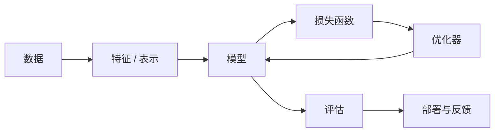
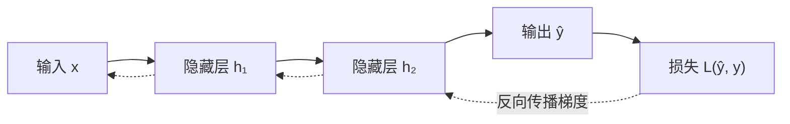
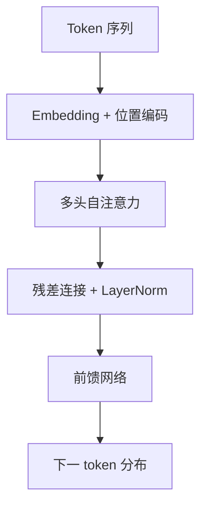

# 人工智能

人工智能不是单一算法，而是一组围绕“从数据与经验中获得决策能力”的方法。传统 AI 关注搜索、表示与推理，机器学习关注从数据中拟合规律，深度学习把表示学习也交给模型，而大模型与智能体则把能力组织成可调用的系统。

**贯穿四年的主线**：表示（如何描述问题）→ 目标（损失函数）→ 优化（如何学习参数）→ 评估（是否真的有效）→ 系统（如何可靠地部署）。

## 1. 从数据到决策

监督学习可以形式化为：给定训练集 $\{(x_i, y_i)\}_{i=1}^{n}$，寻找参数 $\theta$，使模型 $f_\theta$ 在未见数据上的期望损失最小：

$$
\theta^* = \arg\min_\theta \mathbb{E}_{(x,y)\sim p_{\text{data}}}\left[\mathcal{L}(f_\theta(x), y)\right]
$$

实际训练只能用训练集近似这个期望，因此**泛化**才是目标，而不是把训练集拟合到零误差。

## 2. 损失函数与梯度下降

回归任务常用均方误差：

$$
\mathcal{L}_{\text{MSE}} = \frac{1}{n}\sum_{i=1}^{n}\left(\hat{y}_i - y_i\right)^2
$$

分类任务常用交叉熵：

$$
\mathcal{L}_{\text{CE}} = -\sum_{c=1}^{C} y_c \log \hat{y}_c
$$

参数更新遵循梯度下降：

$$
\theta_{t+1} = \theta_t - \eta \nabla_\theta \mathcal{L}(\theta_t)
$$

学习率 $\eta$ 过大容易震荡甚至发散，过小则收敛缓慢。Adam 等自适应优化器通过一阶、二阶矩估计缓解手工调参的困难，但并不能替代对损失曲面的理解。

| 概念 | 作用 | 常见问题 |
| --- | --- | --- |
| 学习率 | 控制步长 | 过大震荡，过小收敛慢 |
| 批量大小 | 估计梯度的样本数 | 过小噪声大，过大泛化可能变差 |
| 正则化 | 限制模型复杂度 | 过强导致欠拟合 |
| 早停 | 防止过拟合 | 需要可靠验证集 |

## 3. 神经网络与反向传播

反向传播是链式法则的系统化应用。对于第 $l$ 层：

$$
\delta^{(l)} = \left(W^{(l+1)\top}\delta^{(l+1)}\right) \odot \sigma'\left(z^{(l)}\right)
$$

$$
\frac{\partial \mathcal{L}}{\partial W^{(l)}} = \delta^{(l)}\left(a^{(l-1)}\right)^\top
$$

其中 $\odot$ 表示逐元素乘法，$\sigma$ 是激活函数。深度网络中的梯度消失或爆炸，正是这些连乘项导致的。

::: tip 先理解计算图
把前向传播写成计算图，反向传播就是对图中每条边求局部导数并按链式法则累乘。框架自动微分做的正是这件事。
:::

## 4. Transformer 与注意力

自注意力让序列中任意两个位置直接交互：

$$
\text{Attention}(Q, K, V) = \text{softmax}\left(\frac{QK^\top}{\sqrt{d_k}}\right)V
$$

缩放因子 $\sqrt{d_k}$ 用于控制点积的方差，避免 softmax 进入饱和区。多头注意力并行学习不同的关系子空间：

$$
\text{MultiHead}(Q,K,V) = \text{Concat}(\text{head}_1, \dots, \text{head}_h)W^O
$$

| 组件 | 解决的问题 | 代价 |
| --- | --- | --- |
| 自注意力 | 长距离依赖 | 序列长度平方复杂度 |
| 位置编码 | 注入顺序信息 | 外推能力受限 |
| 残差连接 | 深层梯度传播 | 增加显存 |
| LayerNorm | 稳定训练 | 推理时需要统计量 |

## 5. 评估：指标决定你优化什么

$$
\text{Precision} = \frac{TP}{TP + FP}, \qquad
\text{Recall} = \frac{TP}{TP + FN}
$$

$$
F_1 = \frac{2 \cdot \text{Precision} \cdot \text{Recall}}{\text{Precision} + \text{Recall}}
$$

| 任务 | 常用指标 | 注意点 |
| --- | --- | --- |
| 分类 | 准确率、F1、AUC | 类别不平衡时准确率会误导 |
| 回归 | MAE、RMSE、$R^2$ | 对异常值敏感度不同 |
| 排序 / 检索 | Recall@K、NDCG | 关注前 K 个结果 |
| 生成 | BLEU、ROUGE、人工评估 | 自动指标与人类判断可能不一致 |

::: warning 离线指标不等于线上效果
数据分布偏移、标注偏差与指标选择都会让离线评估失真。上线前需要小流量验证，上线后持续监控。
:::

## 6. 四年学习路径

1. **大一**：用[线性代数](/01-大一/S2-第二学期/05-线性代数/)理解向量与矩阵，用[微积分 II](/01-大一/S2-第二学期/08-微积分-II/)理解梯度。
2. **大二**：学习传统 AI 的搜索、知识表示与推理，建立“问题建模”意识。
3. **大三**：进入机器学习与深度学习，重点掌握损失、优化、正则化与实验设计。
4. **大四**：学习 Transformer、LLM、RAG 与智能体，把模型能力组织成系统。

## 7. 自测

1. 为什么最小化训练损失不等于获得最好的泛化能力？
2. 交叉熵与均方误差分别适合什么输出分布？为什么？
3. 自注意力为什么需要缩放？不缩放会发生什么？
4. 当正负样本极不平衡时，为什么准确率可能具有误导性？应该看什么指标？

::: info 关联专题
- [数据结构与算法](/知识专题/数据结构与算法)
- [计算机组成原理](/知识专题/计算机组成原理)
- [计算机网络](/知识专题/计算机网络)
:::
