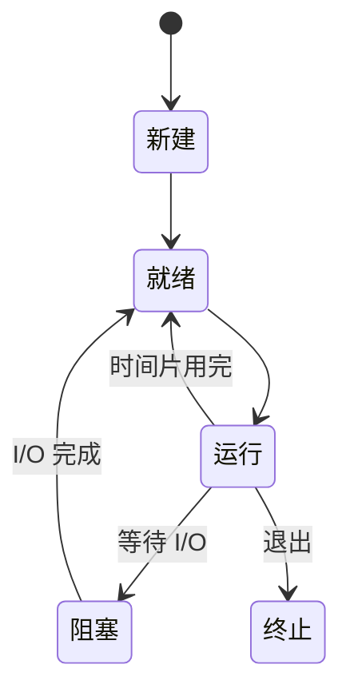
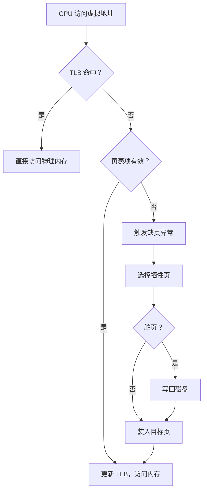

# 操作系统

操作系统是硬件之上的第一层抽象：它把 CPU 变成“进程”，把内存变成“地址空间”，把磁盘变成“文件”，把设备变成“文件描述符”。理解操作系统，就是理解这些抽象如何被实现、又如何在资源竞争下保持正确与高效。

<div class="key-point">

**三条主线**：CPU 虚拟化（进程与调度）、内存虚拟化（地址空间与分页）、持久化（文件与 I/O）。并发问题贯穿三者，是操作系统最容易被低估的部分。

</div>

## 1. 进程与线程

进程是资源分配的单位，线程是 CPU 调度的单位。同一进程内的线程共享地址空间与打开的文件，但各自拥有栈、寄存器和程序计数器。



| 概念 | 共享内容 | 独立内容 | 切换成本 |
| --- | --- | --- | --- |
| 进程 | 无（默认隔离） | 地址空间、文件表、线程 | 高（切换页表） |
| 线程 | 地址空间、文件、信号 | 栈、寄存器、优先级 | 低 |

上下文切换并不是免费的：保存/恢复寄存器、切换页表、刷新 TLB，都会消耗时间。线程数量不是越多越好。

## 2. CPU 调度

调度的目标通常是在**吞吐量、响应时间、公平性**之间取舍。评价指标：

$$
\text{周转时间} = \text{完成时间} - \text{到达时间}
$$

$$
\text{带权周转时间} = \frac{\text{周转时间}}{\text{运行时间}}
$$

| 算法 | 抢占 | 优点 | 缺点 |
| --- | --- | --- | --- |
| FCFS | 否 | 简单、公平 | 长任务拖累短任务 |
| SJF | 否 | 平均周转时间最优 | 需要预知运行时间，可能饥饿 |
| 时间片轮转 | 是 | 响应快、适合交互 | 时间片过小导致切换开销 |
| 多级反馈队列 | 是 | 兼顾交互与批处理 | 参数多，行为难预测 |

::: tip 调度没有“最优解”
只有针对特定工作负载的最优。交互系统更关心响应时间，批处理系统更关心吞吐量，实时系统更关心可预测性。
:::

## 3. 虚拟内存与分页

每个进程看到的是连续的虚拟地址空间，由页表映射到物理页帧。页表项记录有效位、权限位、脏位与访问位。



不考虑缺页时，一次访存的有效访问时间约为：

$$
EAT = h \cdot (t_{TLB} + t_m) + (1-h) \cdot (t_{TLB} + 2t_m)
$$

其中 $h$ 是 TLB 命中率，$t_m$ 是一次内存访问时间。TLB 命中率对性能影响巨大，这也是局部性原理重要的原因。

| 页面置换算法 | 思路 | 问题 |
| --- | --- | --- |
| FIFO | 淘汰最早进入的页 | Belady 异常 |
| LRU | 淘汰最久未使用的页 | 精确实现成本高 |
| Clock | 用访问位近似 LRU | 实现简单、效果接近 |
| OPT | 淘汰未来最晚使用的页 | 不可实现，仅作上界 |

## 4. 并发、同步与死锁

竞态条件的根源是“读—改—写”不是原子操作。下面这段 Python 代码在多个线程同时执行时，最终结果可能小于预期：

```python
counter = 0
lock = threading.Lock()

def worker():
    global counter
    for _ in range(100_000):
        with lock:          # 去掉锁，counter 通常会小于 200000
            counter += 1
```

死锁需要同时满足四个条件：

1. **互斥**：资源一次只能被一个线程占用。
2. **占有并等待**：持有资源的同时等待其他资源。
3. **不可抢占**：资源不能被强制收回。
4. **循环等待**：存在线程与资源的环形等待链。

破坏任意一个条件即可避免死锁。工程上最常见的做法是**固定加锁顺序**，从源头消除循环等待。

::: warning 锁不是越多越安全
锁会带来上下文切换、优先级反转与死锁风险。优先使用不可变数据、消息传递或无锁数据结构，把共享状态降到最低。
:::

## 5. 文件与 I/O

文件系统在“字节流”之上提供命名、目录、权限与持久化。一次读取通常经历：系统调用 → 页缓存 → 块设备驱动 → 磁盘。页缓存命中时，读取几乎只消耗内存带宽。

| I/O 模型 | 特点 | 适用场景 |
| --- | --- | --- |
| 阻塞 I/O | 调用线程睡眠等待 | 简单脚本 |
| 非阻塞 I/O | 立即返回，轮询状态 | 事件循环 |
| I/O 多路复用 | 一个线程管理多个连接 | 高并发服务器 |
| 异步 I/O | 完成后通知 | 高吞吐存储 |

## 6. 学习路径

- 先掌握[计算机组成原理](/知识专题/计算机组成原理)中的 CPU、寄存器与中断，再理解上下文切换。
- 大二系统学习**操作系统**课程，配合 xv6、Linux 源码或 MIT 6.S081 实验。
- 用[数据结构与算法](/知识专题/数据结构与算法)中的队列、堆与哈希理解调度器、定时器与页表。
- 结合[计算机网络](/知识专题/计算机网络)理解 socket 与 I/O 多路复用。

## 7. 自测

1. 进程切换与线程切换分别保存了什么？为什么线程切换更便宜？
2. 为什么 LRU 难以精确实现？Clock 算法如何近似它？
3. 死锁的四个必要条件中，哪一个最容易在工程中破坏？
4. 页缓存命中时，一次 `read` 系统调用到底做了什么？

::: info 关联实验与专题
- [CPU 指令执行模拟](/交互实验/CPU指令执行)
- [计算机组成原理](/知识专题/计算机组成原理)
- [数据结构与算法](/知识专题/数据结构与算法)
:::
