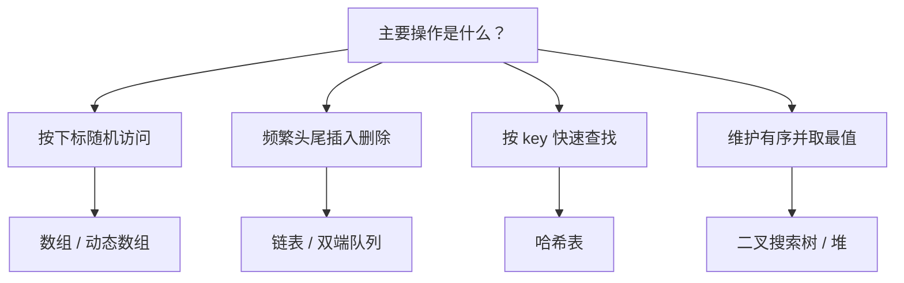
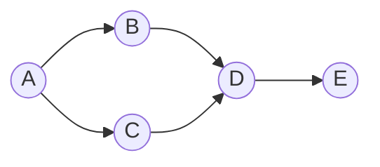

# 数据结构与算法

数据结构的价值不在于“实现过多少种结构”，而在于面对问题时能判断：**数据的访问模式是什么、需要支持哪些操作、哪一类结构的代价最低。** 算法则是把这些操作组织成正确且可分析的步骤。

<div class="key-point">

**三个问题定方向**：数据规模多大？主要操作是查找、插入、删除还是遍历？对顺序、稳定性、内存有什么要求？回答完这三个问题，结构选择通常已经缩小到两三种。

</div>

## 1. 复杂度：描述增长而不是秒数

渐进复杂度忽略常数与低阶项，关注输入规模趋于无穷时的增长趋势。

$$
T(n) = O(f(n)) \iff \exists c > 0, n_0, \forall n \ge n_0: T(n) \le c \cdot f(n)
$$

| 复杂度 | 典型场景 | $n = 10^6$ 时的量级 |
| --- | --- | --- |
| $O(1)$ | 哈希查找、数组下标 | 1 |
| $O(\log n)$ | 二分查找、平衡树 | 约 20 |
| $O(n)$ | 线性扫描 | $10^6$ |
| $O(n \log n)$ | 归并排序、堆排序 | 约 $2 \times 10^7$ |
| $O(n^2)$ | 朴素排序、双重循环 | $10^{12}$ |
| $O(2^n)$ | 子集枚举 | 不可行 |

递归算法的复杂度常由递推式给出。归并排序：

$$
T(n) = 2T\left(\frac{n}{2}\right) + O(n) \Rightarrow T(n) = O(n \log n)
$$

::: tip 先写对，再写快
在数据规模不大时，$O(n^2)$ 的实现可能比复杂的 $O(n \log n)$ 更快。复杂度分析用于排除不可行的方向，而不是替代实际测量。
:::

## 2. 线性结构：数组与链表

| 操作 | 动态数组 | 链表 |
| --- | --- | --- |
| 按下标访问 | $O(1)$ | $O(n)$ |
| 头部插入 | $O(n)$ | $O(1)$ |
| 尾部插入 | 均摊 $O(1)$ | $O(1)$（有尾指针） |
| 中间插入/删除 | $O(n)$ | $O(1)$（已知前驱） |
| 缓存友好性 | 高 | 低 |

数组的“扩容”是均摊 $O(1)$：每次容量翻倍，$n$ 次追加的总复制量是 $O(n)$。这也是为什么动态数组在实际工程中通常优于链表。

```python
def lower_bound(nums, target):
    lo, hi = 0, len(nums)
    while lo < hi:
        mid = (lo + hi) // 2
        if nums[mid] < target:
            lo = mid + 1
        else:
            hi = mid
    return lo
```

二分查找的前提是**有序**，并且每次都能排除一半区间，因此复杂度为 $O(\log n)$。

## 3. 树、堆与哈希



| 结构 | 查找 | 插入 | 删除 | 有序性 |
| --- | --- | --- | --- | --- |
| 哈希表 | 平均 $O(1)$ | 平均 $O(1)$ | 平均 $O(1)$ | 无序 |
| 二叉搜索树 | 平均 $O(\log n)$，最坏 $O(n)$ | 同查找 | 同查找 | 中序有序 |
| 平衡树（AVL/红黑） | $O(\log n)$ | $O(\log n)$ | $O(\log n)$ | 中序有序 |
| 堆 | 取最值 $O(1)$ | $O(\log n)$ | $O(\log n)$ | 局部有序 |

哈希表的核心是哈希函数与冲突处理。负载因子过高会导致冲突链变长，因此需要扩容；这也是哈希表操作“平均”$O(1)$ 而非严格 $O(1)$ 的原因。

[二叉搜索树可视化](/交互实验/数据结构可视化)可以观察插入顺序如何影响树高，以及中序遍历为什么得到升序序列。

## 4. 排序

| 算法 | 平均 | 最坏 | 额外空间 | 稳定 |
| --- | --- | --- | --- | --- |
| 冒泡排序 | $O(n^2)$ | $O(n^2)$ | $O(1)$ | 是 |
| 选择排序 | $O(n^2)$ | $O(n^2)$ | $O(1)$ | 否 |
| 插入排序 | $O(n^2)$ | $O(n^2)$ | $O(1)$ | 是 |
| 归并排序 | $O(n \log n)$ | $O(n \log n)$ | $O(n)$ | 是 |
| 快速排序 | $O(n \log n)$ | $O(n^2)$ | $O(\log n)$ | 否 |
| 堆排序 | $O(n \log n)$ | $O(n \log n)$ | $O(1)$ | 否 |

快速排序的最坏情况出现在每次划分都极不均衡时。随机化选择基准或三数取中可以显著降低这种概率。

[排序算法演示](/交互实验/排序算法演示)把比较与交换过程逐步展开，便于对照复杂度表理解“为什么快”和“什么时候会退化”。

## 5. 图算法



| 算法 | 用途 | 复杂度 | 前提 |
| --- | --- | --- | --- |
| BFS | 无权图最短路径、层序遍历 | $O(V+E)$ | 无 |
| DFS | 连通性、拓扑排序、环检测 | $O(V+E)$ | 无 |
| Dijkstra | 非负权单源最短路 | $O((V+E)\log V)$ | 边权非负 |
| Bellman-Ford | 含负权最短路、负环检测 | $O(VE)$ | 可含负权 |
| Floyd-Warshall | 全源最短路 | $O(V^3)$ | 可含负权 |

Dijkstra 的核心是松弛操作：

$$
d[v] = \min\left(d[v],\ d[u] + w(u, v)\right)
$$

使用优先队列（最小堆）每次取出当前距离最小的节点，保证该节点的最短距离已经确定。

## 6. 动态规划

动态规划适用于具有**最优子结构**与**重叠子问题**的问题。以 0/1 背包为例：

$$
dp[i][c] = \max\left(dp[i-1][c],\ dp[i-1][c-w_i] + v_i\right)
$$

其中 $dp[i][c]$ 表示前 $i$ 个物品、容量为 $c$ 时的最大价值。空间可以用一维数组倒序更新优化到 $O(C)$。

| 问题 | 状态定义 | 转移方向 |
| --- | --- | --- |
| 背包 | 前 $i$ 个物品、容量 $c$ | 容量倒序 |
| 编辑距离 | 前缀 $i$ 与前缀 $j$ | 二维正序 |
| 最长公共子序列 | 前缀 $i$ 与前缀 $j$ | 二维正序 |
| 最短路径（DAG） | 节点距离 | 拓扑序 |

## 7. 学习路径

- 大一先修[数据结构 I](/01-大一/S1-第一学期/04-数据结构-I/)，重点是抽象数据类型与基本实现。
- 第二学期进入[算法与数据结构 II](/01-大一/S2-第二学期/06-算法与数据结构-II/)，系统学习复杂度、图算法与动态规划。
- 用[离散数学 II](/01-大一/S2-第二学期/07-离散数学-II/)补齐图论与计数基础。
- 在[综合实验与复习](/01-大一/S2-第二学期/09-综合实验/)中完成一个端到端项目，练习索引与查询。

## 8. 自测

1. 为什么动态数组的尾部插入是均摊 $O(1)$？请给出摊还分析。
2. 哈希表在什么情况下会退化？如何避免？
3. 快速排序在什么输入下退化为 $O(n^2)$？随机化如何改善？
4. 0/1 背包为什么可以倒序压缩到一维数组？完全背包为什么正序？

::: info 关联实验
- [排序算法演示](/交互实验/排序算法演示)
- [二叉搜索树可视化](/交互实验/数据结构可视化)
:::
