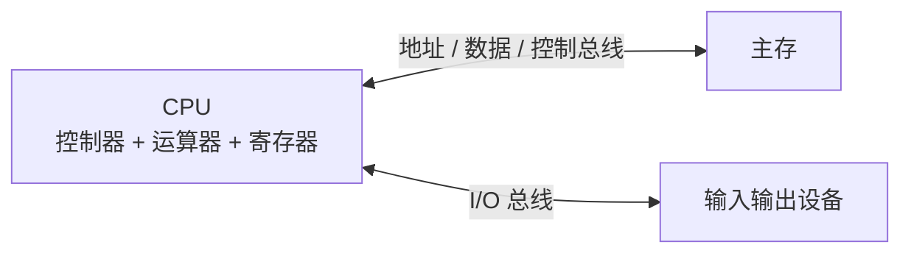

# 计算机组成原理

组成原理回答一个非常具体的问题：**一条高级语言语句，最终如何在硬件上被执行？** 变量存在哪里、整数为什么溢出、数组为什么比链表快、缓存为什么能显著提速，这些问题的答案都在这一层。

**软硬件交界**：指令集是软件与硬件的契约。向上，编译器生成指令；向下，微架构负责取指、译码、执行与访存。理解这条契约，才能解释性能与正确性问题。

## 1. 冯·诺依曼结构

现代计算机仍然是“存储程序”结构：指令与数据存放在同一存储器中，CPU 按程序计数器顺序取指执行。

| 部件 | 职责 | 关键寄存器 |
| --- | --- | --- |
| 控制器 | 取指、译码、发出控制信号 | PC、IR |
| 运算器 | 算术与逻辑运算 | ACC、标志位 |
| 寄存器堆 | 暂存操作数与地址 | 通用寄存器 |
| 主存 | 存放指令与数据 | MAR、MDR |

::: info 冯·诺依曼瓶颈
CPU 与主存之间的带宽远低于 CPU 内部速度，因此需要缓存、流水线与预取来隐藏访存延迟。这也是存储层次结构存在的根本原因。
:::

## 2. 数据表示：二进制与补码

$n$ 位无符号整数的范围是 $0 \sim 2^n - 1$。有符号整数通常使用补码：

$$
x_{\text{补}} =
\begin{cases}
x, & 0 \le x < 2^{n-1} \\
2^n - |x|, & -2^{n-1} \le x < 0
\end{cases}
$$

| 位宽 | 无符号范围 | 有符号补码范围 |
| ---: | --- | --- |
| 8 | 0 ～ 255 | -128 ～ 127 |
| 16 | 0 ～ 65,535 | -32,768 ～ 32,767 |
| 32 | 0 ～ 4,294,967,295 | -2,147,483,648 ～ 2,147,483,647 |

补码的好处是：加法器不需要区分正负，减法可以转化为加法。$n$ 位补码中，最高位是符号位；$-1$ 的位模式是全 1。

你可以用[二进制 / 补码转换器](/交互实验/二进制转换)观察位模式与解释值之间的关系。

## 3. 指令周期：取指—译码—执行

一条 `ADD R1, R2` 指令的执行可以拆成：

1. **取指**：用 PC 去主存取指令，PC 自增。
2. **译码**：识别操作码与操作数，读取寄存器。
3. **执行**：ALU 完成加法。
4. **写回**：结果写回目标寄存器，更新标志位。

[CPU 指令执行模拟](/交互实验/CPU指令执行)用一个小型累加器指令集演示了完整控制流，包括 `JMP` 与 `JZ`。

## 4. 存储层次与局部性

| 层级 | 典型容量 | 访问延迟 | 由谁管理 |
| --- | --- | --- | --- |
| 寄存器 | 几十～几百字节 | < 1 ns | 编译器 |
| L1 缓存 | 32～64 KB | 1～2 ns | 硬件 |
| L2 / L3 缓存 | 数百 KB ～ 数十 MB | 5～40 ns | 硬件 |
| 主存 | GB 级 | 50～100 ns | 操作系统 |
| SSD / 磁盘 | TB 级 | 微秒～毫秒 | 操作系统 |

<figure>
  
  <figcaption>存储层次：越靠近 CPU，容量越小、延迟越低、单位成本越高。</figcaption>
</figure>

平均访存时间（AMAT）：

$$
\text{AMAT} = t_{\text{hit}} + m \times t_{\text{miss}}
$$

其中 $m$ 是缺失率。缓存能生效，依赖两种局部性：

- **时间局部性**：刚访问的数据很可能再次被访问。
- **空间局部性**：访问某个地址后，附近地址很可能被访问。

这解释了两个工程事实：顺序遍历数组通常比链表快；把热点数据放在连续内存中，往往比“逻辑更优雅”的指针结构更高效。

## 5. 流水线

把一条指令拆成多个阶段并行执行，可以提升吞吐量，但不会降低单条指令的延迟。

$$
S = \frac{n \cdot k}{k + (n-1)}
$$

其中 $k$ 是流水级数，$n$ 是指令数。当 $n \to \infty$ 时，加速比趋近于 $k$；但流水线越深，冒险与分支预测失败的代价也越大。

| 冒险类型 | 原因 | 常见处理 |
| --- | --- | --- |
| 结构冒险 | 硬件资源冲突 | 增加端口、分离指令/数据缓存 |
| 数据冒险 | 后一条指令依赖前一条结果 | 转发、停顿、编译器调度 |
| 控制冒险 | 分支导致取指地址不确定 | 分支预测、延迟槽 |

## 6. 学习路径

- 先用[编程与开发工具](/01-大一/S1-第一学期/01-编程与开发工具/)建立 C/C++ 与调试能力，理解指针、内存布局与整数溢出。
- 大二系统学习**计算机组成原理**，配合 Logisim、Verilog 或 RISC-V 模拟器。
- 与[操作系统](/知识专题/操作系统)一起理解中断、上下文切换与页表。
- 用[数据结构与算法](/知识专题/数据结构与算法)分析缓存友好性，而不只看渐进复杂度。

## 7. 自测

1. 为什么补码可以把减法变成加法？8 位补码中 `-5` 的位模式是什么？
2. 一条指令的延迟与吞吐量有什么区别？流水线提升的是哪一个？
3. 顺序访问数组为什么通常比链表快？请从局部性与缓存行角度解释。
4. 分支预测失败为什么代价高？现代 CPU 如何降低这种代价？

::: info 关联实验
- [二进制 / 补码转换器](/交互实验/二进制转换)
- [CPU 指令执行模拟](/交互实验/CPU指令执行)
:::
