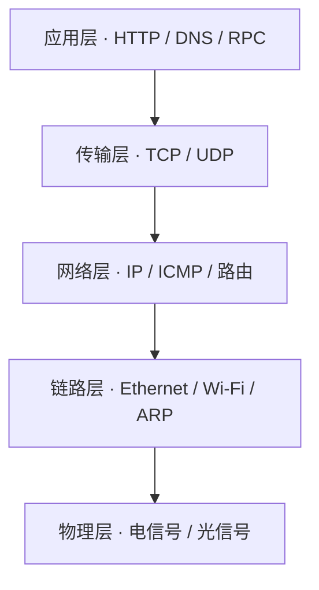
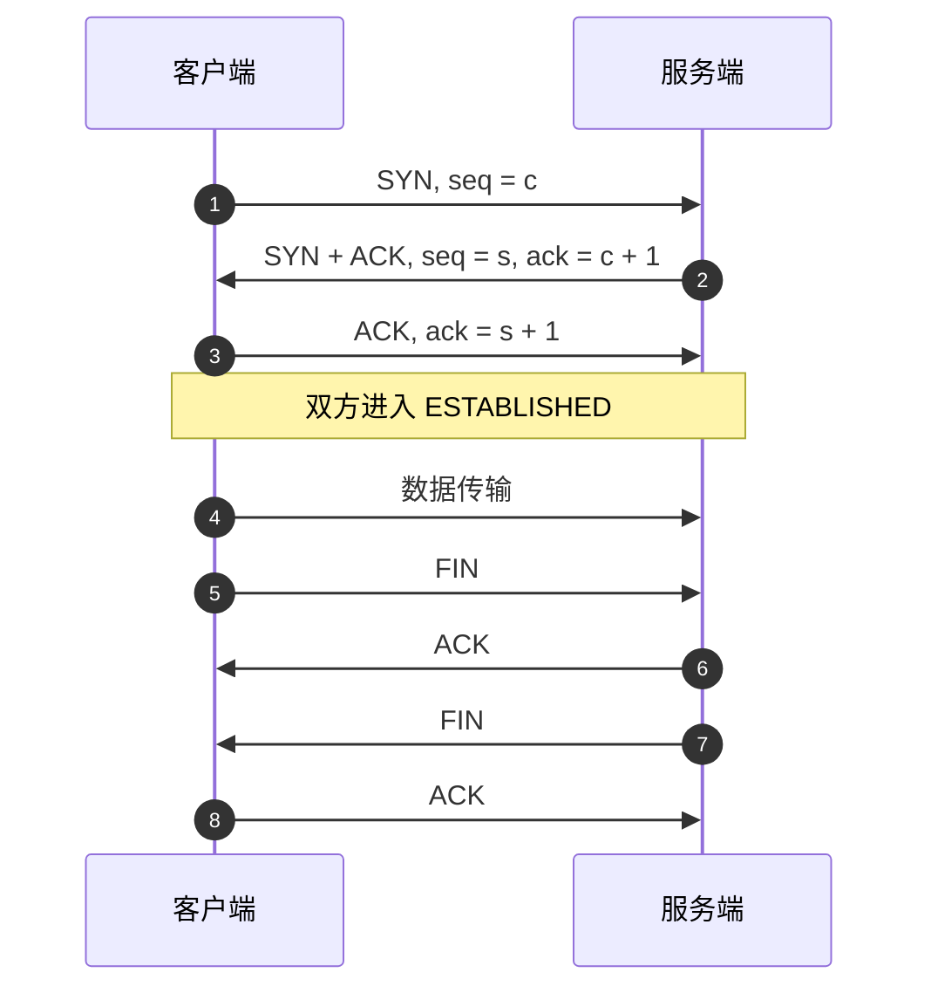
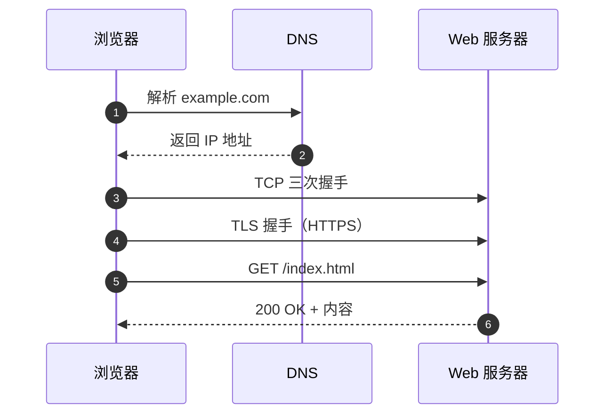

# 计算机网络

网络知识的关键不是背协议，而是理解**分层、封装与端到端责任划分**。同一个“发送一段数据”的动作，在应用层是 HTTP 请求，在传输层是 TCP 报文段，在网络层是 IP 分组，在链路层是帧。每一层只关心自己的职责，并把下一层当作可靠或不可靠的传输管道。

<div class="key-point">

**学习网络的主线**：数据如何被封装 → 如何在不可靠的链路上可靠传输 → 如何被路由到目标 → 应用如何利用这些能力。抓住这条主线，协议细节才不会变成零散记忆。

</div>

## 1. 分层：把复杂性切成可替换的层



| 层 | 数据单元 | 典型协议 | 关注点 |
| --- | --- | --- | --- |
| 应用层 | 消息 | HTTP、DNS、SMTP | 语义与接口 |
| 传输层 | 报文段 / 数据报 | TCP、UDP | 进程到进程、可靠性 |
| 网络层 | 分组 | IP、ICMP | 主机到主机、路由 |
| 链路层 | 帧 | Ethernet、Wi-Fi、ARP | 相邻节点、介质访问 |
| 物理层 | 比特 | — | 信号编码与传输 |

封装的过程像套娃：应用数据加上 TCP 头成为报文段，再加上 IP 头成为分组，再加上以太网头成为帧。接收方逐层拆开，每一层只读取自己的头部。

::: tip 分层不是目的，而是隔离变化
应用层不需要知道底层是 Wi-Fi 还是光纤；传输层也不需要知道分组具体走了哪条路由。只要接口保持稳定，任何一层都可以独立演进。
:::

## 2. 传输层：TCP 与 UDP

| 维度 | TCP | UDP |
| --- | --- | --- |
| 连接 | 面向连接，需握手 | 无连接 |
| 可靠性 | 确认、重传、排序 | 不保证送达 |
| 流量控制 | 滑动窗口 | 无 |
| 拥塞控制 | 有 | 无（由应用自处理） |
| 典型场景 | HTTP/1.1、SSH、数据库 | DNS、视频、游戏、QUIC 底层 |

TCP 的吞吐能力受**窗口大小**与**往返时延 RTT** 共同限制：

$$
\text{吞吐量} \approx \frac{\text{窗口大小}}{\text{RTT}}
$$

链路上真正能容纳的数据量称为带宽时延积（BDP）：

$$
BDP = \text{带宽} \times RTT
$$

如果窗口小于 BDP，发送方就会“等确认”，链路无法跑满。这解释了一个常见现象：高带宽、高延迟的跨地域链路上，单条 TCP 连接的吞吐可能远低于理论带宽。

## 3. 三次握手与四次挥手



三次握手的核心是让双方都确认两件事：

1. 自己的发送能力正常（对方能收到）。
2. 对方的发送能力正常（自己能收到）。

两次握手只能让发起方确认，无法让被动方确认“自己的 SYN-ACK 是否被收到”。第三次 ACK 补上了这一点。

::: warning TIME_WAIT 不是浪费
主动关闭方进入 `TIME_WAIT`，等待 $2 \times MSL$，用于处理迟到的重复报文，并确保最后一个 ACK 丢失时对方重传的 FIN 能被正确响应。
:::

你可以通过[TCP 三次握手模拟](/交互实验/TCP三次握手)逐步观察状态变化与序号确认。

## 4. 一次 HTTP 请求的完整路径



| 版本 | 连接复用 | 队头阻塞 | 典型改进 |
| --- | --- | --- | --- |
| HTTP/1.1 | 持久连接 | 存在 | 管道化、分块传输 |
| HTTP/2 | 单连接多流 | TCP 层仍存在 | 头部压缩、二进制分帧 |
| HTTP/3 | 基于 QUIC/UDP | 基本消除 | 0-RTT、连接迁移 |

一次请求的端到端时间可以粗略拆成：

$$
T = T_{\text{DNS}} + T_{\text{TCP}} + T_{\text{TLS}} + T_{\text{请求往返}} + T_{\text{渲染}}
$$

优化网络性能时，先定位时间花在哪一段，再决定是加缓存、复用连接，还是减少请求数。

## 5. 排障：从现象到工具

| 现象 | 优先检查 | 工具 |
| --- | --- | --- |
| 域名无法解析 | DNS 配置、缓存 | `nslookup`、`dig` |
| 能解析但连不上 | 端口、防火墙、路由 | `telnet`、`nc`、`traceroute` |
| 连接慢、握手久 | RTT、TLS、丢包 | `curl -w`、抓包 |
| 带宽上不去 | 窗口、拥塞、BDP | `iperf3`、`ss` |

```bash
# 查看 DNS、连接、TLS 与首字节时间
curl -o /dev/null -s -w \
  'dns=%{time_namelookup}s connect=%{time_connect}s tls=%{time_appconnect}s ttfb=%{time_starttransfer}s\n' \
  https://example.com
```

## 6. 学习路径

- 先在大一[综合实验与复习](/01-大一/S2-第二学期/09-综合实验/)中体会文件、索引与查询的端到端过程。
- 进入大二后系统学习**计算机网络**课程，重点补齐路由、拥塞控制与网络安全。
- 结合[操作系统](/知识专题/操作系统)理解 socket、文件描述符与 I/O 多路复用。
- 结合[数据结构与算法](/知识专题/数据结构与算法)理解路由表、前缀树与图算法。

## 7. 自测

1. 为什么 TCP 需要三次握手，而 UDP 不需要连接？
2. 在同一条链路上，为什么增加窗口不一定能提升吞吐？
3. HTTP/2 解决了 HTTP/1.1 的哪些问题，又留下了什么瓶颈？
4. 如果一次请求的 TTFB 很高，你会按什么顺序排查？

::: info 关联阅读
- [TCP 三次握手模拟](/交互实验/TCP三次握手)
- [操作系统 · 进程与 I/O](/知识专题/操作系统)
- [数据结构与算法 · 图与最短路径](/知识专题/数据结构与算法)
:::
